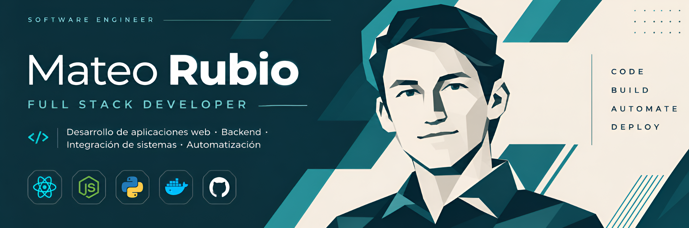

  

    

  
  

  <!-- Activar cuando esté publicado el portafolio.
  
  -->

## Sobre mí

Soy estudiante de Ingeniería de Software en la Universidad Técnica de Ambato, Ecuador, orientado al desarrollo **Full Stack**.

Me interesa construir aplicaciones funcionales, resolver problemas mediante software y automatizar procesos. He participado en proyectos para organizaciones reales, trabajando con tecnologías web, bases de datos, integración de servicios y herramientas de despliegue.

- **Actualmente:** cursando el octavo semestre de Ingeniería de Software.
- **Áreas de interés:** backend, arquitectura de software, automatización e inteligencia artificial.
- **Aprendizaje continuo:** desarrollo de aplicaciones, infraestructura y ciberseguridad.
- **Idiomas:** español nativo e inglés B1.

---

## Stack tecnológico

### Lenguajes de programación

### Frontend

### Backend

### Bases de datos

### Infraestructura y herramientas

### Automatización e inteligencia artificial

---

## Proyectos destacados
### Reconocimiento facial mediante CNN

`Inteligencia artificial` · `Visión por computador` · `2026`

Sistema experimental de reconocimiento facial orientado al control de acceso de personas autorizadas.

Implementa un pipeline de detección de rostros mediante YuNet, alineación, preprocesamiento de imágenes y clasificación utilizando redes neuronales convolucionales.

**Stack:** Python, PyTorch, OpenCV, CNN y YuNet.

*Repositorio pendiente de publicación.*

[Repositorio del proyecto](https://github.com/materubag/FaceAccessCNN)

### CM Stock — Sistema de gestión de muestras

`Proyecto empresarial` · `Full Stack` · `2026`

Sistema de gestión y trazabilidad de muestras desarrollado para una empresa fabricante de pantuflas, actualmente en uso por la organización.

**Mis contribuciones:**

- Configuración inicial del frontend y backend.
- Desarrollo de filtros y tablas para la gestión de información.
- Gestión de imágenes y preparación de datos mediante seeders.

**Stack:** React, Vite, JavaScript, Node.js, PostgreSQL y Docker.

[Repositorio frontend](https://github.com/ARCM-Solutions/CmStock-Frontend) · [Repositorio backend](https://github.com/ARCM-Solutions/CmStock-Backend)

### CONLAC-T — Plataforma de comercio electrónico

`Proyecto de vinculación` · `Frontend` · `2026`

Plataforma web para el Consorcio de Lácteos de Tungurahua, orientada a la promoción de asociaciones y comercialización de productos lácteos.

**Mis contribuciones:**

- Desarrollo de gran parte de la estructura e interfaces del frontend.
- Implementación de componentes reutilizables.
- Integración de servicios y funcionalidades comerciales.

**Stack:** Next.js, React, TypeScript, Tailwind CSS y SQLite.

[Repositorio del proyecto](https://github.com/materubag/Conlac_T_FrontEnd/tree/develop)

### Automatización Trello — GitHub

`Automatización` · `Integración de sistemas` · `2026`

Workflow desarrollado con n8n para automatizar la creación de ramas de desarrollo en GitHub a partir de tarjetas etiquetadas en Trello.

El flujo procesa eventos mediante webhooks, valida las etiquetas de las tarjetas y utiliza la API de GitHub para generar ramas `feature/` desde una rama base.

**Stack:** n8n, Trello API, GitHub API, Webhooks, PostgreSQL y Docker.

[Repositorio del proyecto](https://github.com/materubag/8n8n_das)

---

## Estadísticas de GitHub

